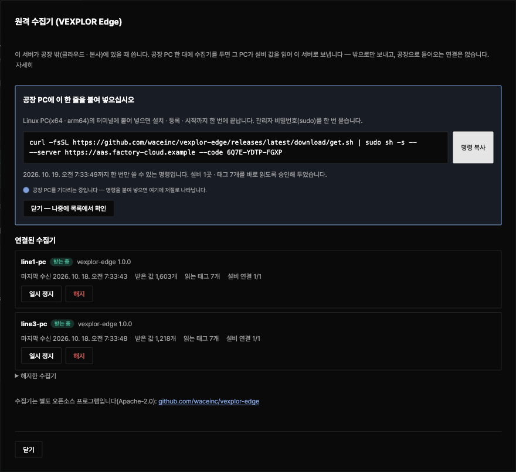

[English](README.md) · **한국어**

# VEXPLOR Edge

**공장 PC 한 대에 두는 원격 수집기. 사람이 승인한 목록의 설비 값만 읽어 HTTPS로 밖으로만 보냅니다.**
공장으로 들어오는 연결도, 원격 정지도, PLC에 쓰는 기능도 없습니다.



## 원클릭 연결

서버(VEXPLOR AAS Studio 2.7.0 이상)의 **「설정 → 원격 수집기」** 화면에서 시작합니다.

1. **「+ 수집기 연결」** — 서버 주소와 지금 읽을 목록(설비 · 태그 수)을 확인하고 「연결 명령 만들기」를 누릅니다.
   「이 목록을 바로 읽게 승인」이 켜져 있으면 승인도 이 단추로 끝납니다.
2. 화면에 나온 **한 줄을 공장 Linux PC의 터미널에 붙여 넣습니다.**

   ```bash
   curl -fsSL https://github.com/waceinc/vexplor-edge/releases/latest/download/get.sh | sudo sh -s -- --server https://aas.example.com --code 7KQ4-M2XD-9PRT
   ```

   이 PC의 CPU에 맞는 판을 내려받아 같은 릴리스의 `SHA256SUMS`와 대조하고, 설치 · 등록 · 서비스 시작까지 한 번에 처리합니다.
3. 화면에 **「받는 중」**이 뜨면 끝입니다. 값은 그 설비 파일의 「수집」 칸에 저절로 들어옵니다.

등록 코드는 24시간 동안 한 번만 쓸 수 있습니다. 화면은 공장 PC를 기다리다가 연결되는 순간 그 PC 이름을 보여 줍니다.
그 뒤로는 같은 화면에서 마지막 수신 시각 · 받은 값 · 설비 연결 상태를 확인하고, 일시 정지 · 다시 시작 · 해지도 할 수 있습니다.

## 언제 쓰나

| 서버 위치 | 쓰는 것 |
|---|---|
| 설비와 같은 망(공장 안 서버) | AAS Studio 서버 안의 수집기 — 이 프로그램이 필요 없습니다 |
| 공장 밖(클라우드 · 본사) | **VEXPLOR Edge** — 공장 PC 한 대가 읽어서 밖으로 보냅니다. 서버가 설비에 닿지 않으므로 「설비에서 불러오기」는 쓰지 못합니다 |
| 공장 밖 + VPN 으로 공장 네트워크와 연결 | 서버가 VPN 을 거쳐 직접 읽습니다 — 이 프로그램 없이도 됩니다 |

설비 값을 읽는 쪽은 설비와 같은 네트워크에 있어야 합니다. 세 경우의 그림과 경우마다 되는 일은 [사용법 1-2절](docs/사용법.md#1-2-그림으로-보는-세-가지-경우)에 있습니다.

PLC 번지 · 레지스터 종류 · 자료형 같은 수집 내용은 공장 PC 가 아니라 AAS Studio 설비 파일의 수집 연결(AID)에서 정합니다.
무엇을 어디서 정하고 값이 어떻게 오가는지는 [사용법 3절](docs/사용법.md#3-설비-연결과-값-수집--무엇을-어디서-정하고-어떻게-읽나)에 있습니다.

받는 쪽은 같은 규격 `vexplor.edge/1`을 따르는 서버입니다. 지금은 VEXPLOR AAS Studio가 받고, VEXPLOR Logic Studio Cloud도
같은 규격으로 받습니다(설계 파트너 회사부터 순서대로 열고 있습니다).

## 하는 일과 하지 않는 일

| | |
|---|---|
| **읽기만** | PLC · 제어기에 쓰는 코드가 없습니다. 설비를 읽는 코드는 AAS Studio 서버의 수집기와 같습니다(OPC UA · Modbus TCP · MQTT) |
| **밖으로만** | 서버 주소 443(또는 현장 프록시)으로만 나갑니다. 포트를 열지 않고, 서버에서 들어오는 길이 없습니다 |
| **승인한 목록만** | 서버에서 사람이 승인한 목록에 있는 태그만 읽습니다. 목록이 바뀌면 다시 승인할 때까지 새 목록을 받지 않습니다 |
| **요청마다 서명** | 등록할 때 이 PC에서 Ed25519 키를 만들고, 모든 요청에 서명합니다. 개인 키는 이 PC를 떠나지 않습니다 |
| **끊겨도 잃지 않음** | 통신이 끊기면 묶음을 디스크에 쌓았다가 순서대로 다시 보냅니다(기본 30일). 서버는 같은 묶음을 한 번만 저장합니다 |
| **바뀐 값만 보내기(선택)** | OPC UA 구독과 불감대. 태그 6개 · 1초 · 5분 실측: 283 KB → 88 KB |
| **원격 정지 없음** | 서버가 내리는 명령이 없습니다. 해지된 장치는 스스로 보내기를 멈추고, 쌓인 값은 지우지 않고 둡니다 |
| **자동 설치 없음** | 새 판 알림만 받을 수 있고, 내려받아 설치하는 일은 사람이 합니다 |

## 설치

- **원클릭** — 위의 한 줄(화면이 서버 주소와 코드를 채워 줍니다).
- **직접** — [Releases](https://github.com/waceinc/vexplor-edge/releases)에서 `vexplor-edge-<판>-linux-x64.tar.gz`(또는 `linux-arm64`)와
  `SHA256SUMS`를 받아 대조한 뒤 `sudo ./install.sh --server … --code …`.

지원: **Linux x64 · arm64**(systemd). Windows는 준비 중입니다. 자세한 안내: [docs/설치.md](docs/설치.md) · 처음부터 끝까지: [docs/사용법.md](docs/사용법.md)

## 문서

- **[사용법](docs/사용법.md)** — 설비 연결과 값 수집이 어떻게 되는지(무엇을 어디서 정하나 · OPC UA · Modbus TCP · MQTT 예), 처음 연결부터 승인 · 상태 읽기 · 정지 · 해지, 공장 PC 의 서비스 · 기록 · 설정 파일 전 항목, 프록시 · 인증서 · PLC 비밀번호, 바뀐 값만 보내기, 판 올리기, 문제 해결까지 화면 캡처와 함께(19장)
- [설치 · 운영](docs/설치.md) — 배치(DMZ · 설비망), 연결하는 곳 전부, 비밀번호 · 인증서, 지우기
- [규격 `vexplor.edge/1`](docs/계약.md) — 등록 · 읽을 목록 · 묶음 · 서명 · 오류. JSON 스키마 [`docs/schemas/`](docs/schemas/)

## 개발

```bash
npm ci && npm run build && npm test          # 단위 시험
git clone https://github.com/waceinc/vexplor-aas ../vexplor-aas && (cd ../vexplor-aas && npm ci && npx tsc -b)
npm run test:interop                         # 실제 AAS Studio 서버와 맞물리는 시험(AAS_DIR 로 위치 지정)
npm run pack:release                         # Linux x64 · arm64 꾸러미 + get.sh + SHA256SUMS
```

설비를 읽는 코드는 VEXPLOR AAS Studio 릴리스 라이브러리(`@aas/collector` · `@aas/fieldbus` · `@aas/opcua`)를 릴리스 주소로
받아 사용합니다. 판을 올리는 절차는 [CONTRIBUTING.ko.md](CONTRIBUTING.ko.md)에 있습니다.

## 판

| VEXPLOR Edge | 규격 | 받는 서버 | 바뀐 것 |
|---|---|---|---|
| 1.0.1 | `vexplor.edge/1` | VEXPLOR AAS Studio 2.3.0 이상(원클릭 화면은 2.7.0 이상) | 끊긴 설비 연결(PLC · MQTT 브로커 재시작, 늦게 켜진 PLC)을 저절로 다시 엽니다. 연결 오류가 상태 화면에 그대로 보입니다([사용법 3-9절](docs/사용법.md#3-9-알아-둘-것)) |
| 1.0.0 | `vexplor.edge/1` | VEXPLOR AAS Studio 2.3.0 이상(원클릭 화면은 2.7.0 이상) | 첫 공개 |

## 라이선스

[Apache License 2.0](LICENSE). "VEXPLOR" · "WACE" 이름과 로고는 이 라이선스에 포함되지 않습니다([NOTICE](NOTICE)).
