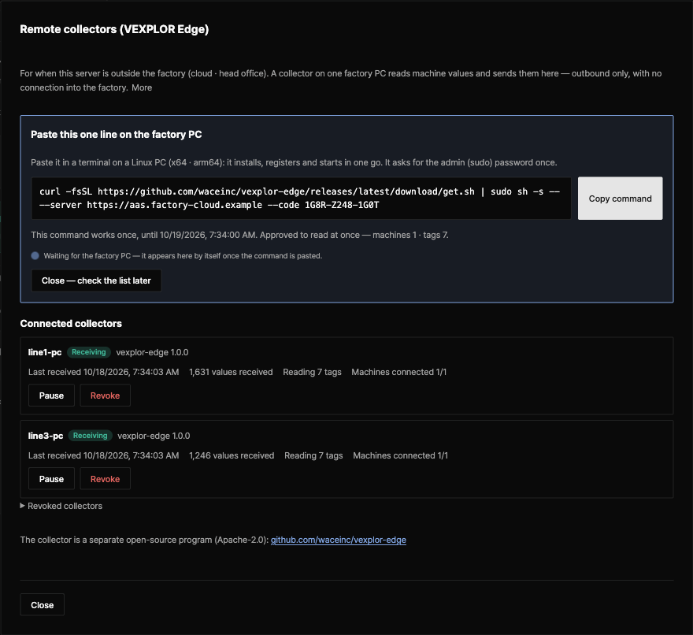

**English** · [한국어](README.ko.md)

# VEXPLOR Edge

**The remote collector you put on one factory PC. It reads only the machine values a person approved and sends them
out over HTTPS — outbound only.** Nothing connects into the factory, there is no remote stop, and it never writes to a
PLC.



## One-click connect

Start on the server — VEXPLOR AAS Studio 2.7.0 or later — under **Settings → Remote collectors**.

1. **"+ Connect a collector"** — check the server address and the list it will read (machines, tags), then press
   "Make the connect command". With "Approve this list so it reads at once" ticked, that press is the approval too.
2. **Paste the one line it shows on the factory PC** — the screen has a Linux and a Windows tab.

   Linux, in a terminal:

   ```bash
   curl -fsSL https://github.com/waceinc/vexplor-edge/releases/latest/download/get.sh | sudo sh -s -- --server https://aas.example.com --code 7KQ4-M2XD-9PRT
   ```

   Windows (1.2.0 and later), in a Command Prompt or PowerShell opened with "Run as administrator":

   ```bat
   powershell -NoProfile -Command "[Net.ServicePointManager]::SecurityProtocol=[Net.ServicePointManager]::SecurityProtocol -bor 3072; & ([scriptblock]::Create((irm https://github.com/waceinc/vexplor-edge/releases/latest/download/get.ps1))) -Server https://aas.example.com -Code 7KQ4-M2XD-9PRT"
   ```

   It downloads the package for the PC, checks it against the release's `SHA256SUMS`, then installs, registers and
   starts the service in one go.
3. **Done when the screen shows "Receiving".** Values appear by themselves in "Collect" for that machine file.

The code works once, for 24 hours. The screen waits for the factory PC and shows its name the moment it connects. The
same screen then shows the last batch, the values received and the machine connections, and pauses, resumes or revokes.

## When to use it

| Where the server is | What reads the machines |
|---|---|
| On the machines' network (a server in the factory) | The collector inside the AAS Studio server — you do not need this program |
| Outside the factory (cloud, head office) | **VEXPLOR Edge** — one factory PC reads and sends out. The server cannot reach the machines, so "Load from equipment" does not work |
| Outside, connected to the factory network by VPN | The server reads them itself through the VPN — no need for this program |

Whatever reads the machines has to be on their network. Pictures of the three cases and what works in each: [user guide §1-2](docs/usage.md#1-2-the-three-cases-in-pictures).

What to collect — PLC addresses, register kinds, data types — is set in the collection link (AID) of the equipment file in
AAS Studio, not on the factory PC. What is set where, and how values travel: [user guide §3](docs/usage.md#3-equipment-links-and-collection--what-is-set-where-and-how-values-are-read).

Any server that follows the contract `vexplor.edge/1` receives it. VEXPLOR AAS Studio does today; VEXPLOR Logic Studio
Cloud receives the same contract too (opened to design-partner companies first, in order).

## What it does — and does not

| | |
|---|---|
| **Read only** | No code writes to a PLC or controller. It reads with the same code as the AAS Studio server's collector (OPC UA, Modbus TCP, MQTT, from 1.2.0 S7 and MC, and from the next release LS ELECTRIC XGT — [below](#protocols)) |
| **Outbound only** | It goes out to the server address on 443 (or the site proxy) and nowhere else. It opens no port; there is no way in |
| **Approved list only** | It reads only the tags in the list a person approved on the server. A changed list waits for a new approval |
| **Every request signed** | On registering it makes an Ed25519 key on the PC and signs every request. The private key never leaves the PC |
| **Nothing lost on an outage** | Batches wait on disk and go out in order when the server answers again (30 days by default); each is stored once |
| **Send changes only (optional)** | OPC UA subscriptions with a deadband. 6 tags, 1 s, 5 minutes measured: 283 KB → 88 KB |
| **No remote stop** | The server sends no commands. A revoked device stops sending by itself and keeps its queue |
| **No auto-install** | It can report a newer signed release; a person downloads and installs it |

## Protocols

| Protocol | Equipment | Port from this PC to the PLC | From |
|---|---|---|---|
| OPC UA | OPC UA servers (PLC, gateway, SCADA) | Usually 4840 | 1.0.0 |
| Modbus TCP | Modbus TCP servers | 502 | 1.0.0 |
| MQTT | MQTT brokers (the last value of a topic) | 1883 · 8883 (TLS) | 1.0.0 |
| **S7** | Siemens S7-300 · 400 · 1200 · 1500 — S7comm over ISO-on-TCP | **102** | 1.2.0 |
| **MC** | MELSEC Q · L · iQ-R · iQ-F — MC protocol, 3E frame, binary code | **The port set in the PLC's Ethernet settings** (no fixed number) | 1.2.0 |
| **XGT** | LS ELECTRIC XGK · XGI · XGR · XGB with an FEnet module — XGT dedicated protocol | **2004** | next release |

S7 and MC are **VEXPLOR extension bindings, read only**: AID 1.1 has no binding for them, so AAS Studio (2.10.0 or
later) writes the address in the AID's standard places and marks the interface with its own binding IRI. Only reading
frames exist in the code (S7 Read Var, MC Batch Read). The frames are tested against test servers built from the
published formats (RFC 1006, ISO 8073, the MELSEC communication protocol reference) — **not yet against real PLCs.**
S7-1200 / 1500 need "Permit access with PUT/GET" on the CPU and "Optimized block access" off on each DB read. An older
collector (1.1.0 or earlier) given an S7 or MC interface does not read it and reports why in its status
(`S7 is not read by this edge yet`); its other machines keep being read.

XGT is the same kind of extension, built from LS ELECTRIC's published "XGT FEnet I/F Module User's Manual" (V2.30,
chapter 8) and tested against a test server that follows it — only the read request (instruction 0x0054) is built.
It needs AAS Studio's next release to write the read list. In XG5000, the FEnet module's driver must be the **XGT server**
(TCP 2004) and, if its host table is on, this PC's address must be in it ([usage §3-3](docs/usage.md)).

**Real PLCs: waiting for user reports.** S7, MC and XGT were built without a real PLC. If you read one, please tell us
what you saw with the [PLC field report](https://github.com/waceinc/vexplor-edge/issues/new?template=field_report.md) — maker, series, CPU, firmware, address, the value you expected and the
value read (or the reason it could not be read).

## Install

- **One click** — the line above (the screen fills in the server and the code).
- **By hand** — from [Releases](https://github.com/waceinc/vexplor-edge/releases) take
  `vexplor-edge-<version>-linux-x64.tar.gz` (or `linux-arm64`) and `SHA256SUMS`, check them, then
  `sudo ./install.sh --server … --code …`. On Windows `vexplor-edge-<version>-win-x64.zip`, then
  `powershell -ExecutionPolicy Bypass -File .\install.ps1 -Server … -Code …` as administrator.

| Supported | Service | From |
|---|---|---|
| Linux x64 · arm64 | systemd `vexplor-edge` | 1.0.0 |
| Windows x64 (Windows 10 / Server 2016 or later, Windows PowerShell 5.1) | Windows service `vexplor-edge` (WinSW), LocalService account, delayed automatic start, restarted after a failure | 1.2.0 |

Full guide: [docs/install.md](docs/install.md) · End to end: [docs/usage.md](docs/usage.md)

## Documents

- **[User guide](docs/usage.md)** — how equipment links and collection work (what is set where, OPC UA · Modbus TCP · MQTT
  · S7 · MC examples), from the first connection to approval, reading a collector's state, pause and
  revoke; the service, log and every configuration key on the factory PC; proxy, certificates, PLC passwords, sending
  changes only, upgrading and troubleshooting, with screen captures (19 sections)
- [Install and run](docs/install.md) — layouts (DMZ, equipment network), every destination it connects to, passwords
  and certificates, removal
- [Contract `vexplor.edge/1`](docs/contract.md) — register, read list, batches, signing, errors. JSON Schema in
  [`docs/schemas/`](docs/schemas/)

## Development

```bash
npm ci && npm run build && npm test          # unit tests
git clone https://github.com/waceinc/vexplor-aas ../vexplor-aas && (cd ../vexplor-aas && npm ci && npx tsc -b)
npm run test:interop                         # against a real AAS Studio server (AAS_DIR sets where)
npm run pack:release                         # Linux x64 · arm64 · Windows x64 packages + get.sh + get.ps1 + SHA256SUMS
```

The equipment readers come from VEXPLOR AAS Studio's release libraries (`@aas/collector`, `@aas/fieldbus`,
`@aas/opcua`), installed by release URL. How to release a version: [CONTRIBUTING.md](CONTRIBUTING.md).

## Versions

| VEXPLOR Edge | Contract | Servers | What changed |
|---|---|---|---|
| 1.2.0 | `vexplor.edge/1` | VEXPLOR AAS Studio 2.3.0 or later (S7 · MC need 2.10.0 or later, and the connect screen's Windows tab is in 2.10.0) | **Windows x64**: a zip package, the Windows service `vexplor-edge` (WinSW, LocalService account, delayed automatic start, restarted after a failure) and the one-line install `get.ps1` ([install — Windows](docs/install.md#windows)). **Reads S7 and MC** — read only, VEXPLOR extension bindings written by AAS Studio 2.10.0 or later, tested against test servers and not yet on real PLCs ([Protocols](#protocols)). A queue file another program holds for a moment (antivirus, indexer) no longer breaks sending, and a settings file saved with a byte order mark is read |
| 1.1.0 | `vexplor.edge/1` | VEXPLOR AAS Studio 2.3.0 or later (one-click screen from 2.7.0, health screen and MQTT login from 2.8.0) | Batch status also reports the factory PC (CPU, memory, disk, uptime, clock offset from the server), the line to the server (last success, last failure, round trip, oldest queued batch) and how equipment answers (response time, read success ratio, reconnects, last disconnect). A server that does not know these fields takes the batches as before ([guide §8-1](docs/usage.md#8-1-pc-line-and-equipment-state-collector-110-and-later)). Reads MQTT broker logins from the factory PC's `credentials.json` ("Login required" in AAS Studio 2.8.0). A full disk no longer stops the collector |
| 1.0.1 | `vexplor.edge/1` | VEXPLOR AAS Studio 2.3.0 or later (the one-click screen from 2.7.0) | Reopens lost equipment connections by itself (a PLC or MQTT broker restarted, a PLC switched on late). Connection errors show on the status screen ([guide §3-9](docs/usage.md#3-9-things-to-know)) |
| 1.0.0 | `vexplor.edge/1` | VEXPLOR AAS Studio 2.3.0 or later (the one-click screen from 2.7.0) | First release |

## License

[Apache License 2.0](LICENSE). The names and logos "VEXPLOR" and "WACE" are not covered by it ([NOTICE](NOTICE)).
