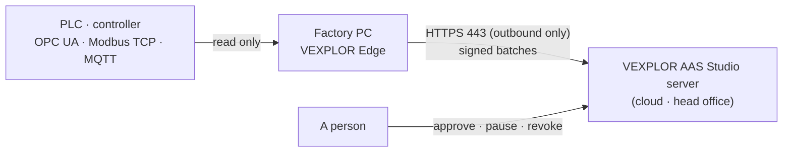

# VEXPLOR Edge — user guide

*한국어: [사용법.md](사용법.md)* · Install summary: [install.md](install.md) · Contract: [contract.md](contract.md)

VEXPLOR Edge is the remote collector you put on one factory PC. It reads only the machines on a list a person approved on
the server, and sends their values out over HTTPS. This guide goes from the first connection through running, trouble
shooting and removal, with the screens and commands in order. Screens are VEXPLOR AAS Studio 2.7.0, the collector is
VEXPLOR Edge 1.0.0, and every capture was taken with a real server, real collectors and a simulated PLC (2026-10-18).

## Contents

1. [What VEXPLOR Edge is](#1-what-vexplor-edge-is)
2. [What you need](#2-what-you-need)
3. [On the server — turn on remote collection](#3-on-the-server--turn-on-remote-collection)
4. [One-click connect](#4-one-click-connect)
5. [Approval — deciding what a collector reads](#5-approval--deciding-what-a-collector-reads)
6. [Seeing the values](#6-seeing-the-values)
7. [Reading a collector's state](#7-reading-a-collectors-state)
8. [Pause · resume · revoke](#8-pause--resume--revoke)
9. [On the factory PC — service, log, files](#9-on-the-factory-pc--service-log-files)
10. [The configuration file `edge.json`](#10-the-configuration-file-edgejson)
11. [Proxy · private CA · PLC passwords · OPC UA certificates](#11-proxy--private-ca--plc-passwords--opc-ua-certificates)
12. [Sending changes only (OPC UA subscriptions · deadband)](#12-sending-changes-only-opc-ua-subscriptions--deadband)
13. [When the line drops — the queue](#13-when-the-line-drops--the-queue)
14. [Upgrading · update notices](#14-upgrading--update-notices)
15. [Installing on a PC without internet](#15-installing-on-a-pc-without-internet)
16. [Removing](#16-removing)
17. [Troubleshooting](#17-troubleshooting)
18. [Security — what it does and does not do](#18-security--what-it-does-and-does-not-do)
- [Appendix. Terms](#appendix-terms)

---

## 1. What VEXPLOR Edge is

When the AAS Studio server is on the same network as the machines, the collector inside the server reads the PLCs
itself. When the server is outside the factory (cloud, head office), it cannot reach them. Put VEXPLOR Edge on one factory
PC and that PC reads the PLCs and sends the values to the server.



| Where the server is | What reads the machines |
|---|---|
| On the machine network (a server in the factory) | The collector inside AAS Studio — you do not need VEXPLOR Edge |
| Outside the factory (cloud · head office) | **VEXPLOR Edge** — one factory PC reads and sends out |

What a collector reads is not decided on the factory PC. The collection links (AID) in the equipment files (AASX) on the
server make the "read list", and a person approves that list on the server before the collector reads anything.

## 2. What you need

**Server**

| Item | Details |
|---|---|
| VEXPLOR AAS Studio | 2.7.0 or later (one-click screen). Servers 2.3.0 – 2.6.x also take contract `vexplor.edge/1`, but are connected through the API and a manual install |
| Address | An **https** address the factory PC can reach. The collector does not talk to a server that is not https (except one on the same PC, for tests). Putting HTTPS in front of the server: AAS Studio usage guide §12-3 |
| Read list | At least one collection link (AID) in an equipment file. Without one, the collector connects but has nothing to read (§3-2) |
| Accounts | An admin turns remote collection on; an account with edit rights makes commands and approves |

**Factory PC**

| Item | Details |
|---|---|
| Operating system | Linux x64 or arm64 with systemd. Windows is in preparation — until then use a Linux PC or a Linux VM on a Windows server |
| Tools | `curl`, `sha256sum` (or `shasum`), admin rights (`sudo`). No Node.js — the program is one executable |
| Download | about 44 MB per package (1.0.0) |
| Outbound | to the server address on 443 (directly or through the site proxy) |
| To the machines | to the PLC ports — OPC UA 4840, Modbus TCP 502, MQTT 1883/8883 |
| Inbound | **none.** The collector opens no port |

Where to place the PC: [install.md](install.md) §1 (DMZ / office network, or the machine network).

## 3. On the server — turn on remote collection

### 3-1. Open the Remote collectors window

In AAS Studio's header, **Settings ▾ → Remote collectors (VEXPLOR Edge)**. When remote collection is off it looks like
this; an admin presses **Turn on remote collection**.


Once on, the window shows **+ Connect a collector** and the list of connected collectors.

The server setting `EDGE` decides whether it can be switched:

| `EDGE` | The window |
|---|---|
| empty (default) | Starts off; an admin turns it on here. It stays on across restarts |
| `on` | Always on. No switch on the screen |
| `off` | No remote collection on this server. The window says the remote collector is off, and the collector API (`/edge/v1`) is not served |

A demo-mode server and a server older than 2.7.0 look like `off`.

### 3-2. Make the read list — collection links (AID) in equipment files

A collector reads the collection links (AID, the AssetInterfacesDescription submodel) of the equipment files on the
server. Open an equipment file and, on the right, **Collect → Create collection link**. The AAS Studio usage guide has the
details: [§8-1](https://github.com/waceinc/vexplor-aas/blob/main/docs/usage.md).

Without any collection link the connect card says "No tags to read yet". You can still connect, and approve later
once a link exists.

## 4. One-click connect

### 4-1. Make the connect command

Press **+ Connect a collector**, check three things and press **Make the connect command**.


| Field | Details |
|---|---|
| Address of this server, as the factory PC reaches it | Filled with the browser's address. If the factory PC sees the server under another name (internal domain, public address), change it |
| Approve this list so it reads at once | On: the list as it is now is approved with the command, and the PC reads as soon as it connects (§5) |
| The list | Each machine (collection link) with its protocol and tag count |

A command works **once**, for 24 hours. It cannot connect a second PC — make one command per PC.

### 4-2. Addresses that would not work

The card stops addresses the factory PC could not use before a command is made:

- `localhost` / `127.0.0.1` point at this computer itself — a warning tells you the factory PC cannot reach it
- `http://` addresses are refused by the collector, so the button is disabled until the address is `https://`

### 4-3. A factory behind a proxy

If the factory PC goes out only through a site proxy, press **Need a proxy?** and enter it. The
command gets `--proxy`. The collector uses an HTTP CONNECT proxy.

### 4-4. Paste it on the factory PC

Press **Copy command**.


Paste it into a terminal on the factory Linux PC. It asks for the admin password once.

```bash
curl -fsSL https://github.com/waceinc/vexplor-edge/releases/latest/download/get.sh | sudo sh -s -- --server https://aas.factory-cloud.example --code AA6B-CYFF-DWZE
```

That one line:

1. downloads the package for the PC's CPU (x64 · arm64) from the latest release
2. checks it against that release's `SHA256SUMS` — on a mismatch it stops without installing
3. puts the program in `/opt/vexplor-edge` and the configuration in `/etc/vexplor-edge/edge.json`
4. makes a signing key on this PC and registers with the code
5. turns on the systemd service `vexplor-edge`, which starts again at every boot

Real output (clean Ubuntu, arm64):

```text
VEXPLOR Edge 1.0.0 (linux-arm64) — downloading
checked against SHA256SUMS
{"time":"2026-10-18T05:18:06.922Z","level":"info","message":"registered as dev_8760c38b60d8a808 — its read list is already approved; it reads as soon as the service starts"}
installed and started: systemctl status vexplor-edge · journalctl -u vexplor-edge
Done. Open the server's 「원격 수집기 (Remote collectors)」 screen: this PC shows as Receiving once values arrive.
If the list was not approved with the command, approve it there — it reads nothing before that.
```

Options you can add:

| Option | Meaning |
|---|---|
| `--proxy http://host:port` | Site proxy (§4-3) |
| `--ca-file corp-ca.pem` | The certificate of a private CA that issued the server's certificate (§11-2) |
| `--credentials-file credentials.json` | PLC user names and passwords (§11-3) |
| `--name "Line 1"` | Name shown on the server. Default: the PC's hostname |
| `--no-service` | Do not register a service (tests · containers) |

### 4-5. Check the connection

The moment the PC registers, the card shows it — while waiting it reads the device list every 3 s. Press **Done**; a
green **Receiving** means the connection is complete.


## 5. Approval — deciding what a collector reads

A collector reads **only a list a person approved.** Two ways:

| How | When |
|---|---|
| Approve with the command ("Approve this list so it reads at once" on) | Usually. It reads as soon as it is pasted |
| Approve after it connects (off) | When the PC goes in first and the list is settled after a site check |

### 5-1. Approving afterwards

With "approve at once" off, the connected PC shows as **Waiting for approval**. It reads nothing and asks the server every
10 s.


**Review and approve** shows the machines, addresses and tag counts it would read; **Approve this list** approves exactly
that.


Within 10 s the collector sees the approval and starts reading.

### 5-2. When equipment files change — "Approve again"

After approval, a changed collection link (a tag added, an address changed, a file added) does **not** reach the
collector: it keeps reading the list as approved, so a list never grows by itself. The row says "The files changed after
approval" and offers **Approve again**; review and approve, and it reads the new list from then on.

If someone changed a file between the card being shown and the button being pressed, the server refuses the stale list and
the card shows the new one. Nobody approves a list they have not seen.

## 6. Seeing the values

Values appear in **the equipment file**, not in the Remote collectors window. Open the file: the **Collect** pane on the
right fills every 10 s and shows **Receiving** while the remote collector sends.


| Shown | Meaning |
|---|---|
| Latest value · time | The last value the collector read from the PLC, and when |
| (empty) + a quality code | The PLC could not give a value (e.g. `BadDeviceFailure`). The collector never makes a value up; it sends the empty value and the reason |
| Daily status | The day's running · stopped · alarm band |

The same values go out through AAS Studio's REST API (`?live=true`) and integrations (MES · ERP · CMMS) — exactly like
values from the server's own collector.

## 7. Reading a collector's state

The window reads the list again every 10 s.

| Badge | Meaning | What to do |
|---|---|---|
| **Receiving** | A batch arrived in the last 3 minutes | Nothing |
| **Waiting for the first values** | Approved, no batch yet | Wait a minute or two |
| **Waiting for approval** | Connected, list not approved | Review and approve (§5-1) |
| **Paused** | A person paused it | Resume |
| **stale** | Nothing for over 3 minutes | See below |
| **Revoked** | Revoked; cannot be undone | Connect again with a new command |

The line under the name:

| Shown | Meaning |
|---|---|
| Last received | When the server last got a batch |
| values received | Values received and stored from this collector, in total |
| Reading n tags | Tags in the approved list |
| Machines connected n/m | Machines the collector is connected to / machines approved. If short, "Machine connection error: …" gives the reason |
| batches waiting to be sent | Batches that piled up on the PC while the line was down and are going out now (§13) |
| Version | The version the collector reported in its last batch (not the one at registration) |

**stale.** A collector sends a batch at least once a minute, even with nothing new. After 3 minutes with nothing, the row
turns **stale** and says what to check: ① is the PC on ② `systemctl status vexplor-edge` (§9) ③ is the way out (443 ·
proxy) open ④ `journalctl -u vexplor-edge` for `read list not reachable` or `sending paused` (§17). When the line comes
back, the queued batches arrive in order and the row returns to Receiving — values from the outage are not lost.

## 8. Pause · resume · revoke

| Button | What it does | Undo |
|---|---|---|
| **Pause** | The collector stops reading (at its next list check, within a minute). The approval stays | **Resume** — reads the approved list again |
| **Revoke** | The server refuses every request from it. The collector stops sending and keeps its queue | None. Connect again with a new command |


Revoke asks once more. Revoked collectors move under "Revoked collectors". When you replace or retire a PC, revoke it on the
server and remove the program on the PC (§16). The server cannot switch a collector off or delete it remotely — on purpose
(§18).

## 9. On the factory PC — service, log, files

| To | Command |
|---|---|
| See if it runs | `systemctl status vexplor-edge` |
| Follow the log | `journalctl -u vexplor-edge -f` |
| Today's log | `journalctl -u vexplor-edge --since today` |
| Restart (after a configuration change) | `sudo systemctl restart vexplor-edge` |
| Stop | `sudo systemctl stop vexplor-edge` |
| Version | `/opt/vexplor-edge/vexplor-edge --version` |

The log is one JSON object per line (time, level, message). Normal lines:

```text
{"time":"…","level":"info","message":"read list ca22b55e3fe65985 (approved): 1 interface(s)"}
{"time":"…","level":"info","message":"running as dev_8760c38b60d8a808, boot 4be5b497-…"}
```

| Where | What | Access |
|---|---|---|
| `/opt/vexplor-edge/vexplor-edge` | The program (one executable) | root |
| `/etc/vexplor-edge/edge.json` | Configuration (§10) | root writes, service account reads |
| `/etc/vexplor-edge/ca.pem` · `credentials.json` | Private CA · PLC passwords given at install (only if given) | root writes, service account reads |
| `/var/lib/vexplor-edge/identity.json` | Device id and this PC's signing key. **Never leaves the PC** | service account only |
| `/var/lib/vexplor-edge/queue` | Batches waiting to be sent | service account only |
| `/var/lib/vexplor-edge/refused` | Batches the server refused as malformed (kept for a person) | service account only |
| `/var/lib/vexplor-edge/opcua-pki` | OPC UA certificates (§11-4) | service account only |
| `/etc/systemd/system/vexplor-edge.service` | The service | root |

The service runs as its own account `vexplor-edge` with reduced rights — no new privileges, a read-only system, and
`/var/lib/vexplor-edge` as the only place it can write.

## 10. The configuration file `edge.json`

The installer writes three keys:

```json
{ "server": "https://aas.factory-cloud.example", "stateDir": "/var/lib/vexplor-edge", "name": "press-line-1" }
```

Every key (restart after a change):

| Key | Default | Meaning |
|---|---|---|
| `server` | (required) | Server address. **https** only (`http://localhost` on the same PC is the one exception). A wrong address stops the start |
| `stateDir` | (required) | Folder for the key, queue and certificates |
| `name` | `VEXPLOR Edge` | Name shown on the server (the list also shows the hostname) |
| `proxy` | none | HTTP CONNECT proxy, `http://host:port` |
| `caFile` | none | PEM of a private CA that issued the server's certificate |
| `credentialsFile` | none | PLC user names and passwords (§11-3) |
| `opcua.pkiDir` | `<stateDir>/opcua-pki` | OPC UA certificate folder |
| `opcua.trustFirstUse` | `false` | Trust an OPC UA server certificate seen for the first time (§11-4) |
| `opcua.mode` | `"poll"` | `"poll"` (read every interval) or `"subscribe"` (changes only, §12) |
| `opcua.deadband` | `0` | Subscribe: absolute deadband for analog tags |
| `opcua.resendMs` | `300000` | Subscribe: resend an unchanged value this often (5 min) |
| `flushIntervalMs` | `5000` | How often collected values become a batch (5 s — 12 a minute) |
| `maxQueuedBatches` | `100000` | Batches kept on disk at most |
| `maxQueueDays` | `30` | Days an unsent batch is kept |
| `update.manifestUrl` · `update.publicKey` | none | Update notices (§14); both are needed |

Relative paths are relative to the configuration file. Read intervals come from the server's read list (the collection
links), not from this file — each tag can have its own.

## 11. Proxy · private CA · PLC passwords · OPC UA certificates

### 11-1. Proxy

At install `--proxy http://proxy.plant.local:3128` (or the proxy field on the card). To change it later, edit `proxy` in
`edge.json` and restart. The proxy must allow CONNECT to the server on 443; otherwise the log says
`proxy refused CONNECT …: 403`.

### 11-2. Private certificate authority

If a company CA issued the server's certificate, pass its certificate (PEM) with `--ca-file corp-ca.pem`. It is copied to
`/etc/vexplor-edge/ca.pem` and set as `caFile`.

### 11-3. PLC passwords

PLC user names and passwords go neither on the server nor in equipment files. The collection link carries only a name
(`credentialRef`); the values stay in a file on the factory PC:

```json
{ "opc.tcp://10.0.0.5:4840": { "userName": "reader", "password": "…" } }
```

Pass it at install with `--credentials-file credentials.json`; it is copied to `/etc/vexplor-edge/credentials.json`
(readable by root and the service account only). If the named entry is missing, that machine does not connect and the
screen shows "no credential named … in the credentials file".

### 11-4. OPC UA certificates

At first start the collector makes its own certificate in `opcua-pki`. With security mode `Sign` or `SignAndEncrypt`, both
sides must trust each other's certificate:

1. A PLC certificate seen for the first time is refused and put in `/var/lib/vexplor-edge/opcua-pki/rejected`
2. After checking it, move it to `opcua-pki/trusted/certs` and restart
3. On the PLC (OPC UA server), trust the collector's certificate (`opcua-pki/own/certs`)

Where the check can be skipped (an installation test), `"opcua": { "trustFirstUse": true }` trusts the first certificate
seen. Not recommended in production.

## 12. Sending changes only (OPC UA subscriptions · deadband)

By default (`"poll"`) every tag is read and sent at its interval. On a thin line or with many tags, switch to OPC UA
subscriptions:

```json
{ "server": "…", "stateDir": "/var/lib/vexplor-edge",
  "opcua": { "mode": "subscribe", "deadband": 1.0, "resendMs": 300000 } }
```

- `subscribe` — the PLC samples each tag at its interval and reports **changes only**
- `deadband` — analog (float) tags do not send changes smaller than this. **Never applied to counters, states or text**
  (a production count rising by 1 under a deadband of 1 would lose every other step)
- `resendMs` — an unchanged value is sent again this often, so the server can tell "unchanged" from "not reading"

Measured (PLC simulator, 6 tags · 1 s · 5 min):

| Mode | Values sent | Size |
|---|---|---|
| Read every time (`poll`) | 1,794 | 283 KB |
| Subscribe | 729 | 130 KB (−54%) |
| Subscribe + deadband 1.0 | 436 | 88 KB (−69%) |

If a PLC refuses subscriptions, the log says `subscription refused, reading every … ms instead` and the collector keeps
reading at the interval.

## 13. When the line drops — the queue

- Values are first written to disk on the PC (`queue`) as batches; a batch is deleted only after the server confirms it
- When the server does not answer (line down · server restart · 429 · 5xx), the same batch is sent again at growing
  intervals (at most 5 min)
- When the line comes back, the queue goes out **oldest first, in order**. The screen shows "n batches waiting to be sent"
  going down to 0
- The server stores a batch once even if it arrives twice (device · boot · sequence)
- Beyond `maxQueuedBatches` (100,000) or `maxQueueDays` (30 days), the oldest are dropped and the count is reported in the
  next batch's status — never silently
- A batch the server refuses as malformed is moved to `refused` for a person to look at

## 14. Upgrading · update notices

The collector never downloads or installs anything by itself; a person upgrades it. Registration (key, device id) lives in
`/var/lib/vexplor-edge`, so replacing the program is enough — no new registration, no new approval:

```bash
V=1.0.0    # the version to install
A=x64      # arm64 on an arm64 PC
curl -fsSLO https://github.com/waceinc/vexplor-edge/releases/download/v$V/vexplor-edge-$V-linux-$A.tar.gz
curl -fsSLO https://github.com/waceinc/vexplor-edge/releases/download/v$V/SHA256SUMS
sha256sum -c SHA256SUMS --ignore-missing
tar xzf vexplor-edge-$V-linux-$A.tar.gz
sudo install -m 0755 vexplor-edge-$V/vexplor-edge /opt/vexplor-edge/vexplor-edge
sudo systemctl restart vexplor-edge
/opt/vexplor-edge/vexplor-edge --version
```

The version on the server screen changes with the next batch. What changed in each version:
[Releases](https://github.com/waceinc/vexplor-edge/releases).

**Update notices (optional).** With `"update": { "manifestUrl": "https://…", "publicKey": "<release key>" }` in
`edge.json`, the collector reads a release manifest once a day and, when one signed by that key names a newer version,
reports it in the log (`update available: …`) and in the next batch's status. A manifest with a bad signature is ignored
and logged. Without both settings no update request is ever made.

## 15. Installing on a PC without internet

If the factory PC cannot reach GitHub, download elsewhere and carry the files over:

1. From [Releases](https://github.com/waceinc/vexplor-edge/releases) take `vexplor-edge-<version>-linux-x64.tar.gz` (or
   `linux-arm64`) and `SHA256SUMS`
2. On the factory PC:

```bash
sha256sum -c SHA256SUMS --ignore-missing
tar xzf vexplor-edge-<version>-linux-x64.tar.gz && cd vexplor-edge-<version>
sudo ./install.sh --server https://aas.factory-cloud.example --code AA6B-CYFF-DWZE
```

The code is the `--code` of the command the screen made. `install.sh` takes the same options as `get.sh` (`--proxy` ·
`--ca-file` · `--credentials-file` · `--name` · `--no-service`). The PC still has to reach the server on 443 (or a proxy).

## 16. Removing

On the factory PC:

```bash
sudo systemctl disable --now vexplor-edge
sudo rm -r /opt/vexplor-edge /etc/vexplor-edge /etc/systemd/system/vexplor-edge.service
sudo systemctl daemon-reload
# only to delete the queue and the key as well
sudo rm -r /var/lib/vexplor-edge
sudo userdel vexplor-edge
```

On the server, **revoke** the collector (§8). A PC removed without revoking stays in the list as stale.

## 17. Troubleshooting

**While installing (`get.sh` · `install.sh`)**

| Message | Cause | What to do |
|---|---|---|
| `this installer is for Linux (Windows is in preparation)` | Not Linux | A Linux PC or VM |
| `unsupported CPU: …` | Not x64 or arm64 | A supported PC |
| `run as root` | Run without `sudo` | Paste the command as shown (`| sudo sh …`) |
| `download failed: …` | GitHub not reachable | Behind a proxy, set `https_proxy` and run `sudo -E sh` (sudo drops environment variables by default), or install directly (§15) |
| `… does not match SHA256SUMS — not installed` | The download differs from the release (tampered or damaged) | Nothing was installed. Download again; if it repeats, check the network equipment |
| `quotes and backslashes are not allowed` | Quotes or backslashes in an address or name | Enter them without |
| `registration refused: 401 RegistrationCodeInvalid` | Code wrong, used, or older than 24 hours | Make a new command on the screen |
| `registration refused: 429 RateLimited` | Many registrations in a short time | Try again shortly |
| `server must be https:// (plain http only on this machine)` | Server address is http | An https address (HTTPS in front of the server) |

**While running (`journalctl -u vexplor-edge`)**

| Log · screen | Cause | What to do |
|---|---|---|
| Screen **stale**, log `read list not reachable: …` | The way out to the server is blocked | Check 443, proxy, DNS. Values are being queued |
| `sending paused … ms: no answer: …` | The server does not answer | Check the server. The same batch is sent again |
| `sending paused … ms: 401 ClockSkew` | The PC's clock is over 5 minutes off the server's | Turn on time sync (NTP) |
| `proxy refused CONNECT …` | The proxy blocks the server on 443 | Allow the server address on the proxy |
| `ALARM: read list refused: 403 DeviceRevoked — sending stopped, the queue is kept` | Revoked on the server | If intended, remove it (§16). If not, connect again with a new command |
| `ALARM: … 401 UnknownDevice …` | The server has no record of this device (its data was reset) | Remove (§16) and connect again with a new command |
| `not registered — run register with a code first` | The service started without registration | Make a command on the screen and install again |
| Screen "Machines connected 0/1" · "Machine connection error: …" | The PLC is unreachable or refuses | PLC address, port firewall, OPC UA certificates (§11-4), passwords (§11-3) |
| Screen stays "Waiting for approval" | Not approved | Review and approve (§5-1) |
| Screen "The files changed after approval" | A collection link changed | Approve again (§5-2) |
| (empty) + `Bad…` in a value | The PLC could not give that tag | Check the tag on the PLC — not a collector problem |

**On the server screen**

| Screen | Cause | What to do |
|---|---|---|
| "Remote collectors are off on this server" | `EDGE=off`, demo mode, or a server older than 2.7.0 | The server admin empties `EDGE` or sets `on` and restarts |
| "Sign in with an admin account to turn it on here." | Not an admin account | An admin turns it on |
| "The server setting EDGE decides this." | `EDGE` fixed to `on`/`off` | Change the server setting |
| "Make the connect command" disabled | Address is http or malformed | §4-2 |
| Making a command or approving fails with "the list changed" | An equipment file changed meanwhile | The card / preview shows the new list; check it and press again |

**Help.** AAS Studio's **? Help** has a short "Remote collectors (VEXPLOR Edge) — one-click connect" topic with the same
flow.

## 18. Security — what it does and does not do

| | |
|---|---|
| **Read only** | No code writes to a PLC or controller. Reading uses the same libraries as the collector inside AAS Studio |
| **Outbound only** | Only to the server address on 443 (or a proxy). It opens no port; the server has no way into the factory |
| **Approved list only** | Only the list a person approved. A changed list is not read until it is approved again |
| **Every request signed** | An Ed25519 key is made on the PC at registration and signs every request. The private key never leaves the PC |
| **Passwords stay on the PC** | PLC passwords are only in a file on the factory PC; the server, equipment files and read list carry only a name |
| **No remote stop** | The server sends the collector no commands. Revoking means the server refuses its requests; the collector stops by itself |
| **No automatic install** | New versions can only be announced; a person installs them |

Every destination it connects to:

| Destination | Why | When |
|---|---|---|
| The configured server on 443 (or `proxy`) | Registration · read list · batches | Always |
| PLC addresses in the approved list (OPC UA · Modbus TCP · MQTT) | Reading values | After approval |
| `update.manifestUrl` | Update notice, once a day | Only if configured |
| GitHub releases | Downloading the package (`get.sh`) | Only while installing |

Found a security problem? See [SECURITY.md](../SECURITY.md).

## Appendix. Terms

| Term | Meaning |
|---|---|
| Collector · device | One VEXPLOR Edge on a factory PC. The server records it by device id (`dev_…`) |
| Registration code | `XXXX-XXXX-XXXX` made by the screen. 24 hours, once |
| Read list | Machines and tags to read, made by the server from the collection links (AID) of equipment files |
| Approval | A person deciding "this list may be read" after seeing it. Bound to the list's revision |
| Batch | Values collected over 5 s, signed and sent together |
| Queue | Where unsent batches wait on the factory PC's disk |
| Contract `vexplor.edge/1` | What the collector and the server exchange — [contract.md](contract.md) |
