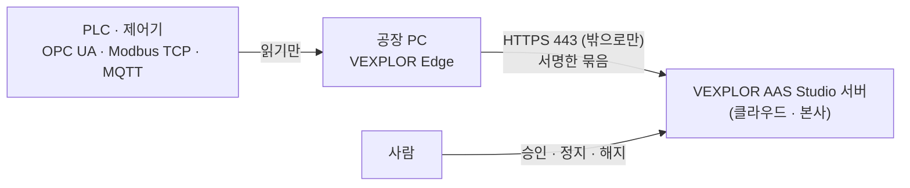

# VEXPLOR Edge 사용법

*English: [usage.md](usage.md)* · 설치 요약: [설치.md](설치.md) · 규격: [계약.md](계약.md)

VEXPLOR Edge 는 공장 PC 한 대에 두는 원격 수집기입니다. 서버에서 사람이 승인한 목록의 설비 값만 읽어 HTTPS 로 밖에
보냅니다. 이 문서는 처음 연결부터 운영 · 문제 해결 · 제거까지 화면과 명령을 순서대로 보여 줍니다. 화면은 VEXPLOR AAS
Studio 2.7.0, 수집기는 VEXPLOR Edge 1.0.0 기준이고, 모든 캡처는 실제 서버 · 실제 수집기 · 가상 PLC 로 찍었습니다
(2026-10-18).

## 차례

1. [VEXPLOR Edge 는 무엇인가](#1-vexplor-edge-는-무엇인가)
2. [준비물](#2-준비물)
3. [서버 쪽 준비 — 원격 수집 켜기](#3-서버-쪽-준비--원격-수집-켜기)
4. [원클릭 연결](#4-원클릭-연결)
5. [승인 — 수집기가 무엇을 읽을지 정하기](#5-승인--수집기가-무엇을-읽을지-정하기)
6. [받은 값 보기](#6-받은-값-보기)
7. [수집기 상태 읽기](#7-수집기-상태-읽기)
8. [일시 정지 · 다시 시작 · 해지](#8-일시-정지--다시-시작--해지)
9. [공장 PC 에서 보기 — 서비스 · 기록 · 파일](#9-공장-pc-에서-보기--서비스--기록--파일)
10. [설정 파일 `edge.json`](#10-설정-파일-edgejson)
11. [프록시 · 사설 인증서 · PLC 비밀번호 · OPC UA 인증서](#11-프록시--사설-인증서--plc-비밀번호--opc-ua-인증서)
12. [바뀐 값만 보내기 (OPC UA 구독 · 불감대)](#12-바뀐-값만-보내기-opc-ua-구독--불감대)
13. [통신이 끊겼을 때 — 대기열](#13-통신이-끊겼을-때--대기열)
14. [판 올리기 · 새 판 알림](#14-판-올리기--새-판-알림)
15. [인터넷이 막힌 PC 에 직접 설치](#15-인터넷이-막힌-pc-에-직접-설치)
16. [지우기](#16-지우기)
17. [문제가 생기면](#17-문제가-생기면)
18. [보안 — 하는 일과 하지 않는 일](#18-보안--하는-일과-하지-않는-일)
- [부록. 용어](#부록-용어)

---

## 1. VEXPLOR Edge 는 무엇인가

AAS Studio 서버가 설비와 같은 망에 있으면 서버 안의 수집기가 직접 PLC 를 읽습니다. 서버가 공장 밖(클라우드 · 본사)에
있으면 서버는 공장 안 PLC 에 닿지 못합니다. 이때 공장 PC 한 대에 VEXPLOR Edge 를 두면, 그 PC 가 PLC 를 읽어 서버로
보냅니다.



| 서버 위치 | 쓰는 것 |
|---|---|
| 설비와 같은 망(공장 안 서버) | AAS Studio 서버 안의 수집기 — VEXPLOR Edge 가 필요 없습니다 |
| 공장 밖(클라우드 · 본사) | **VEXPLOR Edge** — 공장 PC 한 대가 읽어서 밖으로 보냅니다 |

수집기가 무엇을 읽을지는 공장 PC 에서 정하지 않습니다. 서버의 설비 파일(AASX)에 들어 있는 수집 연결(AID)이 「읽을
목록」이 되고, 사람이 서버 화면에서 그 목록을 승인해야 수집기가 읽기 시작합니다.

## 2. 준비물

**서버**

| 항목 | 내용 |
|---|---|
| VEXPLOR AAS Studio | 2.7.0 이상(원클릭 화면). 2.3.0 ~ 2.6.x 서버도 규격 `vexplor.edge/1` 로 받지만, 연결은 API 와 수동 설치로 합니다 |
| 주소 | 공장 PC 가 찾아올 수 있는 **https** 주소. 수집기는 https 가 아닌 서버에 붙지 않습니다(같은 PC 안 시험만 예외). 서버 앞에 HTTPS 를 두는 법은 AAS Studio 사용법 12-3절 |
| 읽을 목록 | 설비 파일에 수집 연결(AID)이 하나 이상. 없으면 연결은 되지만 읽을 것이 없습니다(3-2절) |
| 계정 | 원격 수집을 켜는 일은 관리자, 명령을 만들고 승인하는 일은 편집 권한 계정 |

**공장 PC**

| 항목 | 내용 |
|---|---|
| 운영체제 | Linux x64 또는 arm64, systemd. Windows 판은 준비 중입니다 — 그때까지는 Linux PC 나 Windows 서버 위의 Linux VM 을 사용합니다 |
| 도구 | `curl`, `sha256sum`(또는 `shasum`), 관리자 권한(`sudo`). Node.js 는 필요 없습니다 — 프로그램 하나에 들어 있습니다 |
| 내려받는 크기 | 꾸러미 약 44 MB(1.0.0 기준) |
| 나가는 길 | 서버 주소 443 으로 나가는 길(직접 또는 현장 프록시) |
| 설비 쪽 | PLC 포트에 닿는 길 — OPC UA 4840, Modbus TCP 502, MQTT 1883/8883 |
| 들어오는 길 | **필요 없습니다.** 수집기는 포트를 열지 않습니다 |

PC 를 어디에 둘지는 [설치.md](설치.md) 1절(DMZ · 사무망 / 설비망 두 가지 배치)을 봅니다.

## 3. 서버 쪽 준비 — 원격 수집 켜기

### 3-1. 원격 수집기 창 열기

AAS Studio 머리줄 오른쪽 **「설정 ▾ → 원격 수집기 (VEXPLOR Edge)」** 를 누릅니다.


원격 수집이 꺼져 있으면 아래처럼 나옵니다. 관리자 계정이면 **「원격 수집 켜기」** 를 누릅니다.


켜면 「+ 수집기 연결」 단추와 연결된 수집기 목록이 나옵니다.


켜고 끄는 일은 서버 설정 `EDGE` 가 정합니다.

| `EDGE` 값 | 화면 |
|---|---|
| 비워 둠(기본) | 꺼진 채로 시작하고, 관리자가 이 화면에서 켭니다. 켠 상태는 서버를 다시 시작해도 남습니다 |
| `on` | 늘 켜짐. 화면의 켜기 단추는 나오지 않습니다 |
| `off` | 원격 수집이 없는 서버. 창에 「이 서버에는 원격 수집기가 꺼져 있습니다」가 나오고, 수집기 쪽 주소(`/edge/v1`)도 열리지 않습니다 |

체험 모드 서버와 2.7.0 보다 오래된 서버도 `off` 처럼 보입니다.

### 3-2. 읽을 목록 만들기 — 설비 파일의 수집 연결(AID)

수집기가 읽는 것은 서버에 올라간 설비 파일들의 수집 연결(AID, AssetInterfacesDescription 서브모델)입니다. 설비 파일을
열고 오른쪽 「수집」에서 **「수집 연결 만들기」** 를 누르면 만들어집니다. 자세한 방법은 AAS Studio 사용법
[8-1절 수집 연결 만들기](https://github.com/waceinc/vexplor-aas/blob/main/docs/사용법.md#8-1-수집-연결-만들기)에 있습니다.

수집 연결이 하나도 없으면 「수집기 연결」 카드에 「읽을 태그가 아직 없습니다」가 나옵니다. 그래도 연결은 할 수 있고,
나중에 수집 연결을 만든 뒤 승인하면 됩니다.

## 4. 원클릭 연결

### 4-1. 연결 명령 만들기

**「+ 수집기 연결」** 을 누르면 카드가 열립니다. 세 가지를 확인하고 **「연결 명령 만들기」** 를 누릅니다.


| 칸 | 내용 |
|---|---|
| 공장 PC가 찾아올 이 서버의 주소 | 지금 브라우저 주소로 미리 채워집니다. 공장 PC 에서 보이는 주소가 다르면(사내 도메인 · 공인 주소) 그 주소로 바꿉니다 |
| 이 목록을 바로 읽게 승인 | 켜 두면 이 순간의 읽을 목록을 함께 승인합니다. 공장 PC 가 연결되자마자 읽기 시작합니다(5-1절) |
| 목록 | 설비(수집 연결)마다 이름 · 통신 방식 · 태그 수 |

명령은 24시간 동안 **한 번만** 쓸 수 있습니다. 같은 명령으로 두 번째 PC 를 연결할 수 없습니다 — PC 마다 명령을 따로
만듭니다.

### 4-2. 주소를 잘못 넣으면

공장 PC 가 찾아올 수 없는 주소는 명령을 만들기 전에 막습니다.

`localhost` · `127.0.0.1` 은 이 컴퓨터 자신을 가리키므로 공장 PC 에서는 닿지 않습니다. 경고가 나옵니다.


`http://` 주소는 수집기가 받지 않으므로 단추가 잠깁니다.


### 4-3. 프록시를 거치는 공장

공장 PC 가 현장 프록시로만 밖에 나갈 수 있으면 **「프록시를 거쳐야 하나요?」** 를 누르고 프록시 주소를 넣습니다.
명령에 `--proxy` 가 붙습니다. 수집기는 HTTP CONNECT 프록시를 사용합니다.


### 4-4. 공장 PC 에 붙여 넣기

명령이 나오면 **「명령 복사」** 를 누릅니다.


공장 Linux PC 의 터미널에 붙여 넣습니다. 관리자 비밀번호를 한 번 묻습니다.

```bash
curl -fsSL https://github.com/waceinc/vexplor-edge/releases/latest/download/get.sh | sudo sh -s -- --server https://aas.factory-cloud.example --code TS8M-66F9-KXJ6
```

이 한 줄이 하는 일은 다섯 가지입니다.

1. 그 PC 의 CPU(x64 · arm64)에 맞는 꾸러미를 최신 릴리스에서 내려받습니다
2. 같은 릴리스의 `SHA256SUMS` 와 대조합니다 — 다르면 설치하지 않고 멈춥니다
3. 프로그램을 `/opt/vexplor-edge` 에, 설정을 `/etc/vexplor-edge/edge.json` 에 둡니다
4. 이 PC 에서 서명 키를 만들고 코드로 서버에 등록합니다
5. systemd 서비스 `vexplor-edge` 를 켜고, 부팅할 때마다 다시 시작하게 합니다

실제 출력(깨끗한 Ubuntu, arm64):

```text
VEXPLOR Edge 1.0.0 (linux-arm64) — downloading
checked against SHA256SUMS
{"time":"2026-10-18T05:18:06.922Z","level":"info","message":"registered as dev_8760c38b60d8a808 — its read list is already approved; it reads as soon as the service starts"}
installed and started: systemctl status vexplor-edge · journalctl -u vexplor-edge
Done. Open the server's 「원격 수집기 (Remote collectors)」 screen: this PC shows as Receiving once values arrive.
If the list was not approved with the command, approve it there — it reads nothing before that.
```

명령 뒤에 붙일 수 있는 선택:

| 선택 | 뜻 |
|---|---|
| `--proxy http://host:port` | 현장 프록시(4-3절) |
| `--ca-file corp-ca.pem` | 서버 인증서를 사설 인증 기관이 발급했을 때 그 인증서(11-2절) |
| `--credentials-file credentials.json` | PLC 사용자 이름 · 비밀번호 파일(11-3절) |
| `--name "1라인"` | 서버 목록에 보일 이름. 기본은 PC 이름(hostname) |
| `--no-service` | 서비스를 등록하지 않음(시험용 · 컨테이너) |

### 4-5. 연결 확인

명령을 붙여 넣은 PC 가 서버에 등록하는 순간 화면이 저절로 바뀝니다. 기다리는 동안 화면은 3초마다 목록을 다시 읽습니다.


**「완료」** 를 누르면 목록만 남습니다. 녹색 **「받는 중」** 이 보이면 연결이 끝난 것입니다.


## 5. 승인 — 수집기가 무엇을 읽을지 정하기

수집기는 **사람이 승인한 목록만** 읽습니다. 승인은 두 가지 방법이 있습니다.

| 방법 | 언제 |
|---|---|
| 명령을 만들 때 함께 승인(「이 목록을 바로 읽게 승인」 켬) | 보통의 경우. 붙여 넣으면 바로 읽습니다 |
| 연결된 뒤 따로 승인(끔) | 공장 PC 를 먼저 붙여 두고, 읽을 목록은 현장 확인 뒤 정할 때 |

### 5-1. 따로 승인하기

「이 목록을 바로 읽게 승인」을 끄고 명령을 만들면 안내가 「연결된 뒤 이 화면에서 읽을 목록을 승인해야 값이 들어옵니다」로
바뀝니다.


공장 PC 가 연결되면 **「승인 대기」** 로 나옵니다. 이때 수집기는 아무것도 읽지 않고, 10초마다 서버에 승인 여부를 묻습니다.


**「목록 보고 승인」** 을 누르면 이 수집기가 읽게 될 설비 · 주소 · 태그 수가 나옵니다. 확인하고 **「이 목록으로 승인」** 을
누릅니다.


10초 안에 수집기가 승인을 알아채고 읽기 시작합니다.


### 5-2. 설비 파일이 바뀌면 — 「다시 승인」

승인한 뒤 설비 파일의 수집 연결이 바뀌어도(태그 추가 · 주소 변경 · 파일 추가) 수집기는 **승인한 그때의 목록을 계속
읽습니다.** 목록이 저절로 늘어나지 않게 하기 위해서입니다. 수집기 줄에 「승인한 뒤 파일이 바뀌었습니다」가 나오고
**「다시 승인」** 단추가 생깁니다. 눌러서 새 목록을 확인하고 승인하면 그때부터 새 목록을 읽습니다.

명령을 만드는 사이에 다른 사람이 파일을 바꿨다면 서버는 그 명령을 거절하고(목록이 바뀜) 카드가 새 목록을 다시
보여 줍니다. 본 것과 다른 목록을 승인하는 일은 없습니다.

## 6. 받은 값 보기

값은 원격 수집기 창이 아니라 **그 설비 파일** 에서 봅니다. 파일을 열면 오른쪽 「수집」 칸에 값이 10초마다 들어오고,
원격 수집기가 보내는 동안 「받는 중」이 붙습니다.


| 표시 | 뜻 |
|---|---|
| 최근 값 · 시각 | 수집기가 PLC 에서 읽은 마지막 값과 그 시각 |
| (빈 값) + 품질 코드 | PLC 가 값을 주지 못한 태그(예: `BadDeviceFailure`). 수집기는 가짜 값을 만들지 않고 빈 값과 이유를 그대로 보냅니다 |
| 하루 상태 | 그날의 가동 · 정지 · 알람 띠 |

같은 값은 AAS Studio 의 REST API(`?live=true`)와 연동(MES · ERP · CMMS)으로도 나갑니다 — 서버 안 수집기로 받은 값과
똑같이 다룹니다.

## 7. 수집기 상태 읽기

원격 수집기 창은 10초마다 목록을 다시 읽습니다. 각 줄의 표시는 다음과 같습니다.

| 배지 | 뜻 | 할 일 |
|---|---|---|
| **받는 중** | 최근 3분 안에 묶음이 왔습니다 | 없음 |
| **첫 값 기다리는 중** | 승인했지만 아직 묶음이 오지 않았습니다 | 1~2분 기다립니다 |
| **승인 대기** | 연결됐지만 읽을 목록을 승인하지 않았습니다 | 「목록 보고 승인」(5-1절) |
| **일시 정지 중** | 사람이 멈췄습니다 | 「다시 시작」 |
| **끊김** | 3분 넘게 소식이 없습니다 | 아래 끊김 참고 |
| **해지됨** | 해지했습니다. 되돌릴 수 없습니다 | 다시 쓰려면 새 명령으로 연결 |

줄 아래 숫자:

| 표시 | 뜻 |
|---|---|
| 마지막 수신 | 서버가 마지막으로 묶음을 받은 시각 |
| 받은 값 | 이 수집기에서 받아 저장한 값의 누적 수 |
| 읽는 태그 | 승인한 목록의 태그 수 |
| 설비 연결 n/m | 수집기가 붙어 있는 설비 수 / 승인한 설비 수. 모자라면 「설비 연결 오류: …」에 이유가 나옵니다 |
| 보내지 못하고 쌓인 묶음 | 통신이 끊긴 동안 공장 PC 에 쌓였다가 지금 보내고 있는 묶음(13절) |
| 판 | 수집기가 마지막 묶음에 적어 보낸 지금 판(등록할 때의 판이 아닙니다) |

**끊김.** 수집기는 값이 없어도 1분에 한 번은 묶음을 보냅니다. 3분 넘게 아무것도 오지 않으면 「끊김」이 되고 확인할 곳을
알려 줍니다.


확인 순서: ① 공장 PC 가 켜져 있는지 ② `systemctl status vexplor-edge`(9절) ③ 서버로 나가는 443 · 프록시가 열려 있는지
④ `journalctl -u vexplor-edge` 의 `read list not reachable` · `sending paused` 기록(17절). 통신이 돌아오면 쌓인 묶음이
순서대로 들어오고 「받는 중」으로 돌아옵니다 — 끊긴 동안의 값도 잃지 않습니다.

## 8. 일시 정지 · 다시 시작 · 해지

| 단추 | 하는 일 | 되돌리기 |
|---|---|---|
| **일시 정지** | 수집기가 읽기를 멈춥니다(다음 목록 확인 때, 1분 안). 승인 기록은 남습니다 | 「다시 시작」 — 승인했던 목록으로 다시 읽습니다 |
| **해지** | 그 수집기의 모든 요청을 거절합니다. 수집기는 보내기를 멈추고 쌓인 값은 지우지 않고 둡니다 | 없음. 다시 쓰려면 새 명령으로 연결합니다 |


해지는 한 번 더 묻습니다. 해지한 수집기는 「해지한 수집기」 아래로 내려갑니다.


공장 PC 를 바꾸거나 없앨 때는 서버에서 해지하고, 공장 PC 에서는 프로그램을 지웁니다(16절). 서버가 공장 PC 를 원격으로
끄거나 지우는 기능은 없습니다 — 일부러 두지 않았습니다(18절).

어두운 화면에서도 같은 창입니다(「설정 ▾ → 어두운 화면으로」).


## 9. 공장 PC 에서 보기 — 서비스 · 기록 · 파일

| 하려는 것 | 명령 |
|---|---|
| 돌고 있는지 | `systemctl status vexplor-edge` |
| 기록 보기(실시간) | `journalctl -u vexplor-edge -f` |
| 오늘 기록 | `journalctl -u vexplor-edge --since today` |
| 다시 시작(설정을 바꾼 뒤) | `sudo systemctl restart vexplor-edge` |
| 멈추기 | `sudo systemctl stop vexplor-edge` |
| 판 확인 | `/opt/vexplor-edge/vexplor-edge --version` |

기록은 한 줄에 JSON 하나입니다(시각 · 수준 · 메시지). 정상일 때의 예:

```text
{"time":"…","level":"info","message":"read list ca22b55e3fe65985 (approved): 1 interface(s)"}
{"time":"…","level":"info","message":"running as dev_8760c38b60d8a808, boot 4be5b497-…"}
```

| 위치 | 내용 | 권한 |
|---|---|---|
| `/opt/vexplor-edge/vexplor-edge` | 프로그램(실행 파일 하나) | root |
| `/etc/vexplor-edge/edge.json` | 설정(10절) | root 쓰기, 서비스 계정 읽기 |
| `/etc/vexplor-edge/ca.pem` · `credentials.json` | 설치 때 넘긴 사설 인증서 · PLC 비밀번호(있을 때만) | root 쓰기, 서비스 계정 읽기 |
| `/var/lib/vexplor-edge/identity.json` | 장치 번호와 이 PC 의 서명 키. **밖으로 나가지 않습니다** | 서비스 계정만 |
| `/var/lib/vexplor-edge/queue` | 보내기를 기다리는 묶음 | 서비스 계정만 |
| `/var/lib/vexplor-edge/refused` | 서버가 형식 오류로 거절한 묶음(사람이 보도록 남김) | 서비스 계정만 |
| `/var/lib/vexplor-edge/opcua-pki` | OPC UA 인증서(11-4절) | 서비스 계정만 |
| `/etc/systemd/system/vexplor-edge.service` | 서비스 정의 | root |

서비스는 전용 계정 `vexplor-edge` 로, 권한을 줄인 상태로 돕니다 — 새 권한을 얻지 못하고, 시스템은 읽기 전용이며,
쓸 수 있는 곳은 `/var/lib/vexplor-edge` 하나입니다.

## 10. 설정 파일 `edge.json`

설치기가 만든 `/etc/vexplor-edge/edge.json` 은 보통 세 줄입니다.

```json
{ "server": "https://aas.factory-cloud.example", "stateDir": "/var/lib/vexplor-edge", "name": "press-line-1" }
```

전체 항목(바꾼 뒤 `sudo systemctl restart vexplor-edge`):

| 항목 | 기본 | 뜻 |
|---|---|---|
| `server` | (필수) | 서버 주소. **https** 만 받습니다(같은 PC 안 `http://localhost` 만 예외). 주소가 틀리면 시작하지 않습니다 |
| `stateDir` | (필수) | 키 · 대기열 · 인증서를 두는 폴더 |
| `name` | `VEXPLOR Edge` | 서버에 보일 이름(목록에는 PC 이름이 함께 나옵니다) |
| `proxy` | 없음 | `http://host:port` 형식의 HTTP CONNECT 프록시 |
| `caFile` | 없음 | 서버 인증서를 발급한 사설 인증 기관의 PEM |
| `credentialsFile` | 없음 | PLC 사용자 이름 · 비밀번호(11-3절) |
| `opcua.pkiDir` | `<stateDir>/opcua-pki` | OPC UA 인증서 폴더 |
| `opcua.trustFirstUse` | `false` | 처음 보는 OPC UA 서버 인증서를 믿을지(11-4절) |
| `opcua.mode` | `"poll"` | `"poll"`(주기마다 읽기) 또는 `"subscribe"`(바뀐 값만, 12절) |
| `opcua.deadband` | `0` | 구독 때 아날로그 태그의 불감대(절댓값) |
| `opcua.resendMs` | `300000` | 구독 때 값이 그대로여도 다시 보내는 간격(5분) |
| `flushIntervalMs` | `5000` | 모은 값을 묶음으로 만드는 간격(5초 — 1분에 12번) |
| `maxQueuedBatches` | `100000` | 디스크에 쌓아 둘 묶음 상한 |
| `maxQueueDays` | `30` | 보내지 못한 묶음을 보관하는 날 수 |
| `update.manifestUrl` · `update.publicKey` | 없음 | 새 판 알림(14절). 둘 다 있어야 켜집니다 |

상대 경로는 설정 파일이 있는 폴더 기준입니다. 읽는 주기는 설정 파일이 아니라 서버의 읽을 목록(설비 파일의 수집
연결)이 정합니다 — 태그마다 다르게 둘 수도 있습니다.

## 11. 프록시 · 사설 인증서 · PLC 비밀번호 · OPC UA 인증서

### 11-1. 프록시

설치 때 `--proxy http://proxy.plant.local:3128`(또는 화면의 프록시 칸). 나중에 바꾸려면 `edge.json` 의 `proxy` 를
고치고 다시 시작합니다. 프록시는 서버 주소의 443 으로 CONNECT 를 허용해야 합니다. 거절하면 기록에
`proxy refused CONNECT …: 403` 이 남습니다.

### 11-2. 사설 인증 기관

서버 인증서를 회사 인증 기관이 발급했으면 그 기관 인증서(PEM)를 `--ca-file corp-ca.pem` 으로 넘깁니다.
`/etc/vexplor-edge/ca.pem` 으로 복사되고 `caFile` 이 설정됩니다.

### 11-3. PLC 비밀번호

PLC 사용자 이름 · 비밀번호는 서버에도 설비 파일에도 넣지 않습니다. 설비 파일의 수집 연결에는 이름표(`credentialRef`)만
두고, 실제 값은 공장 PC 의 파일에 둡니다.

```json
{ "opc.tcp://10.0.0.5:4840": { "userName": "reader", "password": "…" } }
```

설치 때 `--credentials-file credentials.json` 으로 넘기면 `/etc/vexplor-edge/credentials.json`(root · 서비스 계정만 읽기)으로
복사됩니다. 이름표에 맞는 항목이 없으면 그 설비는 연결되지 않고 「설비 연결 오류: no credential named … in the
credentials file」이 화면에 나옵니다.

### 11-4. OPC UA 인증서

수집기는 처음 시작할 때 `opcua-pki` 에 자기 인증서를 만듭니다. 보안 모드가 `Sign` · `SignAndEncrypt` 인 OPC UA 서버는
양쪽이 서로의 인증서를 믿어야 연결됩니다.

1. 처음 보는 PLC 인증서는 거절되어 `/var/lib/vexplor-edge/opcua-pki/rejected` 에 놓입니다
2. 확인한 뒤 그 파일을 `opcua-pki/trusted/certs` 로 옮기고 다시 시작합니다
3. PLC(OPC UA 서버) 쪽에서도 수집기 인증서(`opcua-pki/own/certs`)를 신뢰 목록에 넣습니다

설치 시험처럼 확인 절차를 건너뛰어도 되는 곳에서는 `"opcua": { "trustFirstUse": true }` 로 처음 본 인증서를 믿게
할 수 있습니다. 운영에서는 권하지 않습니다.

## 12. 바뀐 값만 보내기 (OPC UA 구독 · 불감대)

기본(`"poll"`)은 정한 주기마다 모든 태그를 읽어 보냅니다. 회선이 좁거나 태그가 많으면 OPC UA 구독으로 바꿉니다.

```json
{ "server": "…", "stateDir": "/var/lib/vexplor-edge",
  "opcua": { "mode": "subscribe", "deadband": 1.0, "resendMs": 300000 } }
```

- `subscribe` — PLC 가 태그마다 정한 주기로 값을 살피고 **바뀐 때만** 보냅니다
- `deadband` — 아날로그(실수) 태그에서 이보다 작은 변화는 보내지 않습니다. **카운터 · 상태 · 글자 태그에는 적용하지
  않습니다**(생산 수량이 1씩 오를 때 불감대 1을 주면 절반이 사라지기 때문입니다)
- `resendMs` — 값이 그대로여도 이 간격마다 다시 보냅니다. 서버가 「안 바뀜」과 「못 읽음」을 구분하게 합니다

실측(PLC 모의기, 태그 6개 · 1초 · 5분):

| 방식 | 보낸 값 | 크기 |
|---|---|---|
| 매번 읽기(`poll`) | 1 794개 | 283 KB |
| 구독(`subscribe`) | 729개 | 130 KB(−54%) |
| 구독 + 불감대 1.0 | 436개 | 88 KB(−69%) |

PLC 가 구독을 거절하면 수집기는 기록에 `subscription refused, reading every … ms instead` 를 남기고 주기 읽기로 바꿔
계속 읽습니다.

## 13. 통신이 끊겼을 때 — 대기열

- 읽은 값은 먼저 공장 PC 디스크(`queue`)에 묶음으로 쌓이고, 서버가 받았다고 답한 묶음만 지웁니다
- 서버가 답하지 않으면(통신 끊김 · 서버 재시작 · 429 · 5xx) 같은 묶음을 늘어나는 간격(최대 5분)으로 다시 보냅니다
- 통신이 돌아오면 쌓인 묶음을 **오래된 것부터 순서대로** 보냅니다. 화면에 「보내지 못하고 쌓인 묶음 n개」가 보이다가 0이
  됩니다
- 서버는 같은 묶음을 두 번 받아도 한 번만 저장합니다(장치 · 부팅 · 순번으로 구분)
- `maxQueuedBatches`(10만)를 넘거나 `maxQueueDays`(30일)보다 오래되면 가장 오래된 것부터 버리고, 버린 수를 다음 묶음의
  상태에 적어 보냅니다 — 소리 없이 버리지 않습니다
- 서버가 형식 오류로 거절한 묶음은 `refused` 폴더로 옮겨 사람이 볼 수 있게 둡니다

## 14. 판 올리기 · 새 판 알림

수집기는 스스로 내려받거나 설치하지 않습니다. 판을 올리는 것은 사람이 합니다. 등록(키 · 장치 번호)은
`/var/lib/vexplor-edge` 에 있으므로 프로그램 파일만 바꾸면 됩니다 — 다시 등록하거나 다시 승인할 필요가 없습니다.

```bash
V=1.0.0    # 올릴 판
A=x64      # arm64 PC 는 arm64
curl -fsSLO https://github.com/waceinc/vexplor-edge/releases/download/v$V/vexplor-edge-$V-linux-$A.tar.gz
curl -fsSLO https://github.com/waceinc/vexplor-edge/releases/download/v$V/SHA256SUMS
sha256sum -c SHA256SUMS --ignore-missing
tar xzf vexplor-edge-$V-linux-$A.tar.gz
sudo install -m 0755 vexplor-edge-$V/vexplor-edge /opt/vexplor-edge/vexplor-edge
sudo systemctl restart vexplor-edge
/opt/vexplor-edge/vexplor-edge --version
```

서버 화면의 판 표기는 다음 묶음부터 새 판으로 바뀝니다. 판마다 바뀐 것은
[Releases](https://github.com/waceinc/vexplor-edge/releases)에 있습니다.

**새 판 알림(선택).** `edge.json` 에 `"update": { "manifestUrl": "https://…", "publicKey": "<릴리스 키>" }` 를 두면 하루에
한 번 릴리스 안내 파일을 읽고, 서명이 맞는 새 판이 있으면 기록(`update available: …`)과 다음 묶음의 상태에 알립니다.
서명이 맞지 않는 안내는 무시하고 기록만 남깁니다. 이 두 값이 없으면 업데이트를 묻는 요청 자체를 보내지 않습니다.

## 15. 인터넷이 막힌 PC 에 직접 설치

공장 PC 가 GitHub 에 닿지 못하면 다른 PC 에서 내려받아 옮깁니다.

1. [Releases](https://github.com/waceinc/vexplor-edge/releases)에서 `vexplor-edge-<판>-linux-x64.tar.gz`(또는 `linux-arm64`)와
   `SHA256SUMS` 를 받습니다
2. USB 등으로 공장 PC 에 옮긴 뒤:

```bash
sha256sum -c SHA256SUMS --ignore-missing
tar xzf vexplor-edge-<판>-linux-x64.tar.gz && cd vexplor-edge-<판>
sudo ./install.sh --server https://aas.factory-cloud.example --code TS8M-66F9-KXJ6
```

코드는 서버 화면이 만든 명령의 `--code` 값입니다. `install.sh` 는 `get.sh` 와 같은 선택(`--proxy` · `--ca-file` ·
`--credentials-file` · `--name` · `--no-service`)을 받습니다. 공장 PC 는 서버 443(또는 프록시)에는 닿아야 합니다.

## 16. 지우기

공장 PC 에서:

```bash
sudo systemctl disable --now vexplor-edge
sudo rm -r /opt/vexplor-edge /etc/vexplor-edge /etc/systemd/system/vexplor-edge.service
sudo systemctl daemon-reload
# 대기열과 키까지 지울 때만
sudo rm -r /var/lib/vexplor-edge
sudo userdel vexplor-edge
```

서버에서는 그 수집기를 **해지** 합니다(8절). 해지하지 않고 PC 만 지우면 목록에 「끊김」으로 남습니다.

## 17. 문제가 생기면

**설치할 때(`get.sh` · `install.sh`)**

| 나온 글 | 원인 | 할 일 |
|---|---|---|
| `this installer is for Linux (Windows is in preparation)` | Linux 가 아닌 PC | Linux PC 또는 Linux VM |
| `unsupported CPU: …` | x64 · arm64 가 아닌 CPU | 지원 CPU 의 PC |
| `run as root` | `sudo` 없이 실행 | 명령을 그대로(`| sudo sh …`) 붙여 넣기 |
| `download failed: …` | GitHub 에 닿지 않음 | 프록시 뒤라면 `https_proxy` 를 설정하고 `sudo -E sh` 로 실행(sudo 는 기본으로 환경 변수를 넘기지 않습니다), 아니면 15절 직접 설치 |
| `… does not match SHA256SUMS — not installed` | 내려받은 파일이 릴리스와 다름(중간 변조 · 손상) | 설치하지 않은 상태입니다. 다시 받고, 반복되면 네트워크 장비 확인 |
| `quotes and backslashes are not allowed` | 주소 · 이름에 따옴표 · 역슬래시 | 따옴표 없이 입력 |
| `registration refused: 401 RegistrationCodeInvalid` | 코드가 틀렸거나, 이미 쓰였거나, 24시간이 지남 | 화면에서 명령을 새로 만들기 |
| `registration refused: 429 RateLimited` | 짧은 시간에 등록을 여러 번 시도 | 잠시 뒤 다시 |
| `server must be https:// (plain http only on this machine)` | 서버 주소가 http | https 주소로(서버 앞에 HTTPS) |

**돌고 있을 때(`journalctl -u vexplor-edge`)**

| 기록 · 화면 | 원인 | 할 일 |
|---|---|---|
| 화면 「끊김」, 기록 `read list not reachable: …` | 서버로 나가는 길이 막힘 | 443 · 프록시 · DNS 확인. 값은 대기열에 쌓이고 있습니다 |
| `sending paused … ms: no answer: …` | 서버가 답하지 않음 | 서버 상태 확인. 같은 묶음을 다시 보냅니다 |
| `sending paused … ms: 401 ClockSkew` | 공장 PC 시계가 서버와 5분 넘게 다름 | PC 시간 동기화(NTP) 켜기 |
| `proxy refused CONNECT …` | 프록시가 서버 443 을 막음 | 프록시에 서버 주소 허용 |
| `ALARM: read list refused: 403 DeviceRevoked — sending stopped, the queue is kept` | 서버에서 해지됨 | 의도한 것이면 16절로 지우기. 아니면 새 명령으로 다시 연결 |
| `ALARM: … 401 UnknownDevice …` | 서버에 이 장치 기록이 없음(서버 데이터를 새로 만듦) | 새 명령으로 다시 연결(16절로 지운 뒤 설치) |
| `not registered — run register with a code first` | 등록 없이 서비스가 시작됨 | 화면에서 명령을 만들어 다시 설치 |
| 화면 「설비 연결 0/1」 · 「설비 연결 오류: …」 | PLC 에 닿지 않거나 거절 | PLC 주소 · 포트 방화벽 · OPC UA 인증서(11-4절) · 비밀번호(11-3절) |
| 화면 「승인 대기」가 그대로 | 승인하지 않음 | 「목록 보고 승인」(5-1절) |
| 화면 「승인한 뒤 파일이 바뀌었습니다」 | 설비 파일의 수집 연결이 바뀜 | 「다시 승인」(5-2절) |
| 값 칸에 (빈 값) + `Bad…` | PLC 가 그 태그 값을 주지 못함 | PLC 쪽 태그 상태 확인. 수집기 문제가 아닙니다 |

**서버 화면에서**

| 화면 | 원인 | 할 일 |
|---|---|---|
| 「이 서버에는 원격 수집기가 꺼져 있습니다」 | `EDGE=off`, 체험 모드, 2.7.0 보다 오래된 서버 | 서버 관리자가 `EDGE` 를 비우거나 `on` 으로 두고 다시 시작 |
| 「관리자 계정으로 로그인하면 여기서 켤 수 있습니다」 | 관리자가 아닌 계정 | 관리자가 켜기 |
| 「서버 설정 EDGE 가 정해 두었습니다」 | `EDGE=on`/`off` 로 고정 | 서버 설정에서 바꾸기 |
| 「연결 명령 만들기」가 잠김 | 주소가 http 이거나 형식이 틀림 | 4-2절 |
| 「미리 본 뒤 목록이 바뀌었습니다 — 다시 보고 승인하십시오.」 | 명령을 만들거나 승인하는 사이에 설비 파일이 바뀜 | 카드 · 미리 보기가 새 목록을 다시 보여 줍니다. 확인하고 다시 누르기 |

**도움말.** AAS Studio 「? 도움말」의 「원격 수집기 (VEXPLOR Edge) — 원클릭 연결」 항목에 같은 흐름이 짧게 있습니다.


## 18. 보안 — 하는 일과 하지 않는 일

| | |
|---|---|
| **읽기만** | PLC · 제어기에 쓰는 코드가 없습니다. 읽는 코드는 AAS Studio 서버 안 수집기와 같은 라이브러리입니다 |
| **밖으로만** | 서버 주소 443(또는 프록시)으로만 나갑니다. 포트를 열지 않고, 서버가 공장 안으로 들어오는 길이 없습니다 |
| **승인한 목록만** | 사람이 서버에서 승인한 목록만 읽습니다. 목록이 바뀌어도 다시 승인할 때까지 옛 목록만 읽습니다 |
| **요청마다 서명** | 등록할 때 공장 PC 에서 Ed25519 키를 만들고 모든 요청에 서명합니다. 개인 키는 PC 를 떠나지 않습니다 |
| **비밀번호는 PC 에만** | PLC 비밀번호는 공장 PC 파일에만 있고, 서버 · 설비 파일 · 읽을 목록에는 이름표만 있습니다 |
| **원격 정지 없음** | 서버가 수집기에 내리는 명령이 없습니다. 해지는 서버가 요청을 거절하는 것이고, 수집기는 스스로 보내기를 멈춥니다 |
| **자동 설치 없음** | 새 판은 알림만 받을 수 있고, 설치는 사람이 합니다 |

수집기가 연결하는 곳은 아래가 전부입니다.

| 목적지 | 이유 | 언제 |
|---|---|---|
| 설정의 서버 주소 443(또는 `proxy`) | 등록 · 읽을 목록 · 묶음 | 늘 |
| 승인한 목록의 PLC 주소(OPC UA · Modbus TCP · MQTT) | 값 읽기 | 승인 뒤 |
| `update.manifestUrl` | 새 판 알림(하루 한 번) | 설정했을 때만 |
| GitHub 릴리스 | 설치 때 꾸러미 내려받기(`get.sh`) | 설치할 때만 |

보안 문제를 찾으면 [SECURITY.ko.md](../SECURITY.ko.md)의 방법으로 알려 주십시오.

## 부록. 용어

| 말 | 뜻 |
|---|---|
| 수집기 · 장치 | 공장 PC 에서 도는 VEXPLOR Edge 하나. 서버에는 장치 번호(`dev_…`)로 기록됩니다 |
| 등록 코드 | 화면이 만드는 `XXXX-XXXX-XXXX`. 24시간 · 한 번만 |
| 읽을 목록 | 서버가 설비 파일의 수집 연결(AID)에서 만든, 수집기가 읽을 설비 · 태그 목록 |
| 승인 | 사람이 그 목록을 보고 「이 목록을 읽어도 된다」고 정하는 것. 목록의 판(revision)에 묶입니다 |
| 묶음 | 수집기가 5초마다 모은 값을 서명해 한 번에 보내는 단위 |
| 대기열 | 보내지 못한 묶음이 공장 PC 디스크에서 기다리는 곳 |
| 규격 `vexplor.edge/1` | 수집기와 서버가 주고받는 약속. [계약.md](계약.md) |
